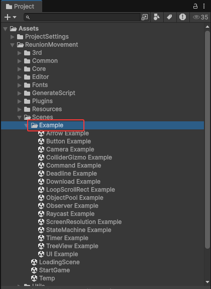
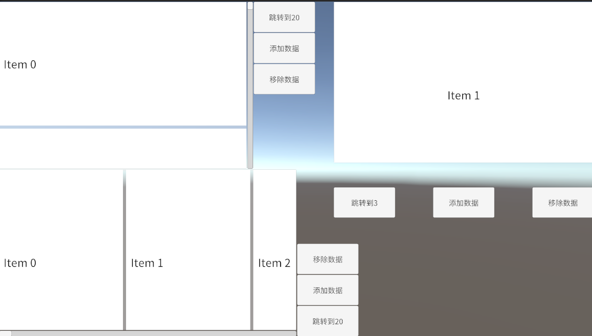
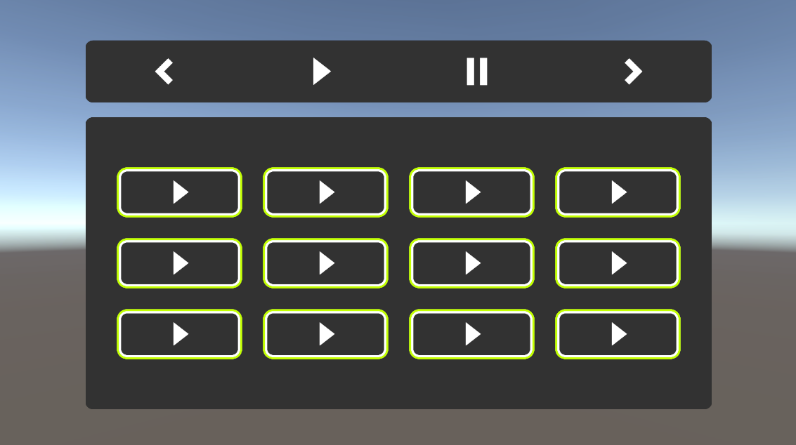
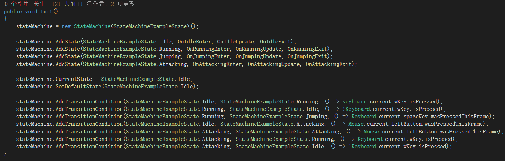
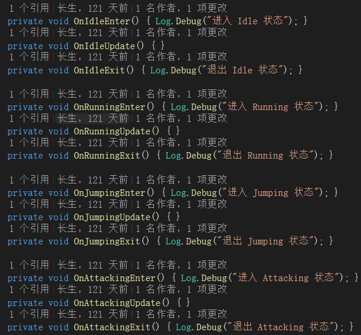

# 特性与示例

> 本文件由根 `README.md` 拆分而来，用于保留完整的特性清单与示例 GIF。返回 [README](../README.md)。

## 特性

- **零分配日志**：ZString 池化缓冲 + `[Conditional]` 条件编译，日志格式化零 GC。
- **响应式事件总线**：R3 Subject 驱动的 `EventMessageSystem`，含泛型零装箱通道。
- **统一生命周期引擎**：纯 C# `GameEngine` + `GameEngineDriver` 桥接，模块化 `ICustomSystem`，`[RuntimeInitializeOnLoadMethod]` 自动启动。
- **四传输网络层**：TCP(Telepathy) / KCP(kcp2k) / WebSocket(SimpleWebTransport) / RawTcp(原生 Socket) 统一 `INetworkChannel` 抽象，可插拔帧编解码器（MessageId / LengthPrefixed / Passthrough）+ 压缩 + 加密（Encrypt-then-MAC）+ 心跳、自动重连、断线可靠消息重发、RPC 请求/响应。
- **断点续传下载**：HTTP 分块下载（>2GB 支持）、MD5 校验、多线程并发调度、超时兜底、暂停 / 恢复。
- **热更完整性保护**：Remote 模式强制 `https://`（拒绝明文 http）；首次远程 Catalog 与内嵌 `version.json` 锚点（catalogHash）核对，防中间人替换热更内容；单文件下载按 Content-Length 校验完整性。
- **SDF 形状 UI**：`ImageEx` 基于 SDF 着色器实现 12 种形状（四边形 / 心形 / 六边形 / 星形 / 圆角等）+ 渐变 / 模糊 / 描边 / 过渡特效；`ImageExReplica`（相机画面投影）、`ImageExTweener`（参数动画）。
- **循环滚动列表**：`LoopScrollRect` 对象池 + 虚拟化 + 数据索引缓存，滚动零 GC、选中状态零 GetComponent。
- **UI Toolkit 面板系统**：`UIToolkitSystem` 异步加载 UXML/USS，面板栈管理。
- **WebGL 体积优化**：ImageEx Shader 变体剥离器（过渡 / 模糊 / 描边组合裁剪）。
- **崩溃日志上报**：`ErrorReporter` 全局错误捕获（Error/Exception/Assert）+ 本地落盘（1MB 轮转）+ 同类错误聚合 + 可选 HTTP 上报。
- **通用存档**：`SaveSystem` JSON 原子写入存档（版本字段 + 自动迁移）。
- **性能监控**：`PerformanceMonitor` 每秒 FPS/托管内存采样 + 防抖告警。
- **网络消息协议**：`NetworkMessageCodec` / `NetworkMessageDispatcher` 消息 ID 编解码与分发（异常隔离）。
- **热更状态机**：`AddressableUpdateFlow` 检查→下载→应用流程（R3 可观测，UI 可直接绑定）。
- **Addressables 统一封装**：`AddressableSystem` 加载 / 实例化 / 场景 / 释放 / 双轨降级 / 远程更新；一键流水线（迁移→构建 Content→上传 OSS）。
- **并发去重加载**：`SingleFlightLoader` 同 key 并发请求合并为一次（UI / 音频 / 面板接入）。
- **暂停系统**：`PauseSystem` 统一暂停 / 恢复（多原因互斥 + R3 可观测 + 全局音频协调，兼容慢动作）。
- **通用对象池**：`GameObjectPool` + `IPoolable` 生命周期 + 注册表管理。
- **轮播式选择**：`CarouselSelectionController` 线性 / 矩阵模式导航（键盘 / 手柄），支持不规则行与空位。

## 工具

- **表格工具**：Excel → 脚本 / ScriptableObject / JSON（批量生成，支持自定义数组类型）
- **碰撞器工具**：编辑模式 Gizmo 可视化显示碰撞器
- **文件夹工具**：项目内快速打开/定位文件夹
- **UI 工具**：CreateUIPlane 一键生成 UI 面板脚本（含覆盖保护）
- **小功能窗口**：场景切换 / 屏幕日志 / FPS / UI 波纹（全部支持 Undo）
- **ImageEx**：SDF 形状图片 + 渐变/模糊/描边/过渡特效
- **ImageEx Editor**：形状/特效参数可视化编辑，含相机画面（Camera Feed）接入
- **Shader 变体剥离器**：WebGL 构建体积优化
- **Addressables 流水线**：一键迁移（UI/音频/图片/配置/预制体/场景/字体）→ 构建 Content → 上传 OSS（菜单：Gear → Addressables）
- **打包工具**：一键导出 `Gear.unitypackage`（菜单：Gear → 打包 → 导出 .unitypackage）
- **轮播选择控制器**：`CarouselSelectionController` 线性 / 矩阵模式选择（角色 / 车辆等界面，键盘 / 手柄导航）

> **框架保留工具**（暂无调用点，作为框架能力保留，请勿删除）：`VibrationUtil`、`ScreenCaptureUtil`、`AssemblyUtil`、`ColorUtil`、`EncryptUtil`、`TimeUtil`、`GachaSystem`、`Billboard`、`DeadlineMgr`。

## 系统一览

| 系统 | 说明 |
|---|---|
| `GameEngine` / `Bootstrap` | 纯 C# 引擎生命周期，自动启动，测试场景自动跳过场景跳转 |
| `EventMessageSystem` | 响应式事件总线（R3 Subject + 泛型零装箱） |
| `LanguagesSystem` | 多语言本地化（TextMeshPro 自动翻译） |
| `ResourcesSystem` | Resources 加载 + 引用计数缓存 + 图集 |
| `AddressableSystem` | Addressables 统一封装（加载 / 实例化 / 场景 / 释放 / 双轨降级 / 远程更新） |
| `SingleFlightLoader` | 并发去重加载（同 key 请求合并为一次） |
| `PauseSystem` | 统一暂停 / 恢复（多原因互斥 + R3 可观测 + 全局音频协调） |
| `SceneSystem` | 场景加载（进度 / 过渡场景 / 并发锁 / 状态恢复 / 取消令牌） |
| `SoundSystem` | 音乐/音效（LRU 缓存 / 淡入淡出 / 对象池 / 并发去重加载 / 双轨加载） |
| `UISystem` | uGUI 窗口管理（加载 / 打开 / 关闭 / 层级 / 静态 UI / 超时） |
| `UIToolkitSystem` | UI Toolkit 面板管理（异步加载 / 面板栈） |
| `UIInputSystem` | 输入模式切换（Gameplay ↔ UIControl）、键盘/手柄 UI 导航、焦点栈 |
| `TerminalSystem` | 运行时控制台（`[RegisterCommand]` 源码生成器注册） |
| `NetworkMgr` | 多通道网络管理（TCP / KCP / WebSocket / RawTcp，跨场景持久） |
| `DownloadMgr` | 多文件断点下载 / 图片下载（暂停 / 恢复） |
| `HttpMgr` | HTTP 请求封装（GET / POST / 进度 / 取消） |
| `TimerMgr` | 计时器 / 倒计时 |
| `StateMachine` | 泛型状态机（并行状态 / 超时 / 历史回退 / 序列化快照） |
| `GachaSystem` | 加密随机抽卡系统（无可预测性 / 保底持久化 + 完整性校验） |
| `GameObjectPool` | 通用对象池（IPoolable 生命周期 / 注册表） |
| `ResolutionMgr` | 屏幕分辨率 / 全屏 / 帧率（仅桌面平台；移动端分辨率由系统控制，不会调用 `Screen.SetResolution`） |
| `SafeArea` | 刘海屏安全区适配 |
| `ScreenLogger` | 屏幕日志显示 |
| `DeadlineMgr` | 截止日期检测 |
| `ErrorReporter` | 全局错误捕获 / 日志落盘（轮转 + 聚合）/ 可选上报 |
| `SaveSystem` | 通用 JSON 存档（原子写入 + AES+HMAC 加密完整性 + 版本迁移） |
| `PerformanceMonitor` | FPS / 内存采样与防抖告警 |
| `NetworkMessage` | 消息 ID 编解码 + 分发器（协议层） |
| `AddressableUpdateFlow` | Addressables 热更状态机（检查→下载→应用） |

## 示例

示例场景位于 `Assets → Gear → Scenes → Example`。

**Arrow Example** —— 展示箭头

**Button Example** —— 展示 Button

**Camera Billboard Example** —— 展示摄像机（Billboard 跟随 + Camera Feed 相机画面）

**ColliderGizmo Example** —— 展示编辑模式显示碰撞器工具

**Command Example** —— 展示 Command 工具，该场景演示了如何实现 Undo / Redo

**Deadline Example** —— 展示 Deadline 工具，该工具用于截止日期检测

**Download Example** —— 展示下载

**ImageEx Example** —— SDF 形状 UI：12 种形状 + 渐变 / 模糊 / 描边 / 过渡（着色器 `Gear/UI/ImageEx`）

**LoopScrollRect Example** —— 展示循环列表

**Music Example** —— 展示音乐播放

**Raycast Example** —— 展示射线例子

**ScreenResolution Example** —— 展示屏幕分辨率工具

**StateMachine Example** —— 展示状态机的使用

**Timer Example** —— 展示计时和倒计时的使用

**TreeView Example** —— 展示树状图

**Network Example** —— 展示网络连接与数据传输（TCP / KCP / WebSocket / RawTcp）

**ObjectPool Example** —— 展示通用对象池的使用

**CSG Example** —— 展示 CSG 布尔运算工具

**Shader Graph Example** —— 展示 Shader Graph 与 URP 结合

**UI Example** —— 展示 UISystem 窗口管理、ImageEx 特效与按钮动画

> 另含网络示例：MultiNetworkChannel（四传输对比）、SimpleWebTransport（Web 服务端）
